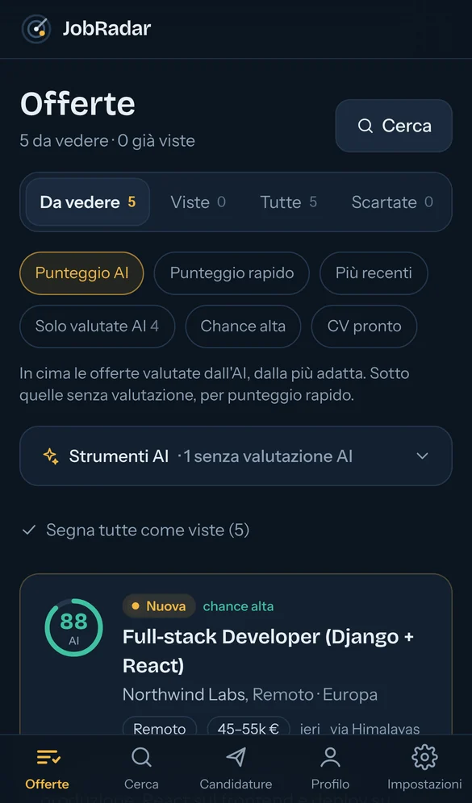

# JobRadar

Web app personale per cercare lavoro in tutto il mondo (remoto, Europa e oltre), preparare CV e lettere su misura con l'AI e tracciare le candidature. Interfaccia in italiano, pensata per il telefono e installabile come app (PWA).

**Online:** [job-radar-km.vercel.app](https://job-radar-km.vercel.app) (l'accesso è protetto da password: è un'app personale)



<sub>Schermata con offerte di esempio.</sub>

## In breve

- **Sette fonti ufficiali in parallelo** più le pagine carriere Greenhouse, Lever e Ashby, con deduplica tra fonti.
- **Filtri scritti in codice e testati**: freschezza, anti-truffa, idoneità geografica per un cittadino UE, lingua e un punteggio di compatibilità calcolato senza AI.
- **Claude come recruiter severo**: valuta ogni offerta con output JSON validato da zod, poi prepara CV e lettera su misura nella lingua dell'annuncio.
- **Controllo anti-invenzioni**: dopo la generazione il codice toglie dal CV aziende, formazione, competenze e numeri che non compaiono nel CV originale.
- **Pensata per serverless**: nessuna richiesta lunga, le operazioni in blocco le orchestra il browser con una coda di richieste in parallelo.
- **Stack**: Next.js 16, React 19, TypeScript, Tailwind CSS 4, PostgreSQL con Drizzle ORM, API di Claude, PDF e Word generati lato server, test con Vitest.

## Cosa fa

1. **Profilo**: carichi il tuo CV (PDF o Word) → l'AI lo trasforma in un *CV master* strutturato che puoi correggere. Qui indichi anche ruoli cercati, parole da escludere, modalità (remoto/ibrido/in sede), disponibilità a trasferirti, lingue con livello.
2. **Cerca**: mostra cosa stai cercando (ruoli, modalità, livello, fonti) e ti fa scegliere chi dà il punteggio: *solo punteggio rapido*, *AI sulle migliori N* (predefinito) o *AI su tutte le nuove* (max 100). Poi interroga in parallelo tutte le fonti attive, una richiesta per fonte (o per paese/azienda), elimina i duplicati, scarta le offerte senza chance concrete e assegna il punteggio come scelto. Alla fine vedi quante offerte sono state scartate e perché.
3. **Offerte**: schede *Da vedere* (mai aperte, con il badge "Nuova"), *Viste*, *Tutte* e *Scartate* (con *Ripristina*); ordinamento per punteggio o per data di arrivo. Un'offerta diventa "Vista" quando apri i dettagli o l'annuncio, oppure con il pulsante a forma di occhio (che la riporta anche tra le "Da vedere"); *Segna tutte come viste* svuota la lista. *Prepara N candidature* genera in blocco CV + lettera su misura per le migliori N. Su ogni offerta: *Apri annuncio*, download CV/lettera in PDF e Word, *Candidato* (va nel tracker con la data), *Non mi interessa* (va tra le Scartate, con Annulla subito e Ripristina dopo).
4. **Candidature**: stato (inviata, colloquio, offerta, rifiutato), note, CV usato, promemoria di follow-up dopo 10 giorni, export CSV.

### Fonti (solo API pubbliche e ufficiali)

| Fonte | Cosa copre |
|---|---|
| [Himalayas](https://himalayas.app) | lavori remoti, con restrizioni di località e fuso orario |
| [Remote OK](https://remoteok.com) | lavori remoti. "Apri annuncio" porta al link di candidatura dell'azienda, quando Remote OK lo fornisce (le offerte nuove su Remote OK possono essere riservate agli abbonati Premium); "via Remote OK" porta al loro annuncio |
| [Jobicy](https://jobicy.com) | lavori remoti |
| [Jooble](https://jooble.org) | aggregatore mondiale; una richiesta per località scelta in Impostazioni (serve chiave gratuita; restituisce solo un estratto dell'annuncio) |
| [The Muse](https://www.themuse.com) | aziende internazionali, remoto e principali città europee, filtrate per livello di seniority |
| [Arbeitnow](https://www.arbeitnow.com) | Europa (soprattutto Germania), con info sul visto |
| [Adzuna](https://www.adzuna.com) | annunci per paese (gb us de fr it nl es at be ch pl ca au nz sg in mx br za) |
| Pagine carriere | Greenhouse, Lever, Ashby: incolli il link della pagina careers dell'azienda |
| A mano | incolli un annuncio trovato su LinkedIn/Indeed: viene valutato e tracciato come gli altri |

Ogni offerta mostra sempre "via *fonte*" con il link. Il pulsante **🔍 Sito dell'azienda** apre una ricerca Google già compilata per trovare lo stesso annuncio sulla pagina careers dell'azienda, dove di solito ci si candida gratis e senza intermediari.

### Filtri

- **Freschezza**: scarta gli annunci più vecchi di 21 giorni (configurabile).
- **Anti-truffa**: niente annunci senza nome azienda, con Telegram/WhatsApp, richieste di pagamento, "commission only", MLM.
- **Idoneità geografica**: da cittadino UE puoi lavorare in UE + Islanda, Liechtenstein, Norvegia, Svizzera. Per il remoto vengono tenute le offerte worldwide/Europa/EMEA/Italia e scartate quelle "solo USA", "must be located in the US", "authorized to work in the US", "security clearance", ecc. Per il lavoro in sede fuori da quest'area l'offerta resta solo se parla di sponsor del visto (e non dice "no sponsorship").
- **Lingua**: scarta gli annunci scritti in una lingua che non parli, o che richiedono una lingua che non parli almeno a livello B2 (i "nice to have" sono ignorati).
- **Match rapido 0-100** (senza AI): titolo vs ruoli cercati, competenze trovate, seniority, anni di esperienza richiesti, parole escluse.

### AI (Claude)

- **Offerte con punteggio AI sotto 20** (soglia in Impostazioni, 0 = mai) vanno subito tra le *Scartate*: le ricerche non le ripropongono più, ma puoi ripristinarle.
- **Valutazione** con il modello veloce (default `claude-haiku-5-5`): recruiter severo, una chiamata per offerta, JSON validato con zod (punteggio, chance, sintesi, punti di forza, cosa manca, ostacoli, lingua della candidatura, parole chiave).
- **CV + lettera su misura** con il modello di scrittura (default `claude-sonnet-5-5`) nella lingua dell'annuncio. L'AI può solo selezionare, riordinare, riformulare e tradurre dal CV master. Dopo la generazione un **controllo in codice** toglie aziende e formazione assenti dal master, forza le date del master, toglie competenze/certificazioni/lingue che non hai e i punti elenco con numeri o metriche che non compaiono nel master. Le correzioni fatte vengono mostrate.
- Con `claude-sonnet-5-5` (e Opus/Fable) è attivo il *fallback lato server* di Anthropic: se il modello rifiuta una richiesta per un falso positivo dei filtri di sicurezza, la stessa richiesta viene ripetuta automaticamente su un altro modello.
- **Senza chiave Anthropic l'app funziona lo stesso**: ricerca, filtri, punteggio rapido e tracker. Il profilo va compilato a mano.

## Avvio in locale

Serve Node.js 20 o superiore.

```bash
npm install
cp .env.example .env      # poi compila i valori (vedi sotto)
npm run db:migrate        # crea le tabelle nel database
npm run dev               # http://localhost:3000
```

Altri comandi:

```bash
npm test                  # test (Vitest)
npm run build             # build di produzione
npm run db:generate       # crea una nuova migrazione dopo aver modificato src/lib/db/schema.ts
```

## Database gratuito

Va bene qualsiasi Postgres. Due opzioni gratuite:

**Neon** (consigliato)
1. Registrati su [neon.tech](https://neon.tech) e crea un progetto (regione Europa, es. Frankfurt).
2. In *Connection Details* attiva **Pooled connection** e copia la stringa `postgresql://…?sslmode=require`.
3. Mettila in `DATABASE_URL`.

**Supabase**
1. Crea un progetto su [supabase.com](https://supabase.com).
2. *Project Settings → Database → Connection string → URI*, modalità **Transaction pooler** (porta 6543).
3. Sostituisci `[YOUR-PASSWORD]` e mettila in `DATABASE_URL`.

Poi, dal tuo computer, con `DATABASE_URL` nel file `.env`:

```bash
npm run db:migrate
```

Va rifatto solo quando aggiorni l'app e c'è una nuova migrazione nella cartella `drizzle/`.

## Dove prendere le chiavi

| Variabile | Obbligatoria | Dove |
|---|---|---|
| `DATABASE_URL` | sì | Neon o Supabase (vedi sopra) |
| `APP_PASSWORD` | sì | scegli tu una password lunga: serve per entrare nell'app |
| `SESSION_SECRET` | sì | stringa casuale di almeno 32 caratteri: `openssl rand -hex 32` |
| `ANTHROPIC_API_KEY` | no | [console.anthropic.com](https://console.anthropic.com) → *API Keys* (servono crediti) |
| `ADZUNA_APP_ID`, `ADZUNA_APP_KEY` | no | registrazione gratuita su [developer.adzuna.com](https://developer.adzuna.com) |
| `JOOBLE_API_KEY` | no | gratuita: richiedila su [jooble.org/api/about](https://jooble.org/api/about) |
| `THEMUSE_API_KEY` | no | facoltativa anche se usi The Muse (funziona senza): alza i limiti, su [themuse.com/developers](https://www.themuse.com/developers/api/v2) |
| `CRON_SECRET` | no | stringa casuale: abilita la ricerca automatica ogni mattina |

Lo stato di tutte le variabili (impostata / mancante, mai il valore) è visibile in **Impostazioni**.

## Deploy su Vercel

1. Importa il repository su [vercel.com/new](https://vercel.com/new) (framework: Next.js, nessuna modifica ai comandi).
2. In *Settings → Environment Variables* aggiungi: `DATABASE_URL`, `APP_PASSWORD`, `SESSION_SECRET` e, se le usi, `ANTHROPIC_API_KEY`, `ADZUNA_APP_ID`, `ADZUNA_APP_KEY`, `JOOBLE_API_KEY`, `THEMUSE_API_KEY`, `CRON_SECRET`.
3. Esegui `npm run db:migrate` dal tuo computer puntando allo stesso database.
4. Deploy. Apri l'app dal telefono e usa "Aggiungi a schermata Home" per installarla.

**Ricerca automatica (facoltativa)**: `vercel.json` programma `/api/cron/search` ogni giorno alle 06:00 UTC. Vercel invia `Authorization: Bearer $CRON_SECRET`; senza `CRON_SECRET` la route risponde 503. Il cron fa solo ricerca + filtri (niente AI); la valutazione AI parte quando apri l'app e premi *Valuta con AI*.

## Note tecniche

- **Next.js 16** (App Router) + TypeScript + Tailwind 4, Postgres con Drizzle ORM, `@anthropic-ai/sdk`, PDF con `@react-pdf/renderer`, Word con `docx`, lettura CV con `unpdf` e `mammoth`, validazione con zod.
- **Login**: `src/proxy.ts` (in Next.js 16 il "middleware" si chiama *proxy*) blocca pagine e API senza un cookie di sessione valido, firmato HMAC e `httpOnly`, valido 30 giorni.
- **Vincolo serverless**: nessuna API fa lavori lunghi. Ogni chiamata gestisce una fonte (o un paese Adzuna, o un'azienda) oppure una offerta. Le operazioni in blocco (ricerca, valutazione, "Prepara N candidature") le orchestra il browser con una coda di 3-4 richieste in parallelo e una barra di avanzamento. Se una fonte fallisce le altre continuano.
- **Mai sovrascrivere**: una nuova ricerca non ripropone né modifica offerte a cui ti sei candidato o che hai scartato. Lo stesso annuncio trovato su più fonti viene salvato una volta sola (chiave azienda + titolo).
- Ogni fonte è un modulo in `src/lib/sources/` con una funzione `parse()` pura e testata; tutto viene normalizzato nel tipo `Job` (`src/lib/types.ts`).
- I filtri sono in `src/lib/filters/`, il controllo anti-invenzioni in `src/lib/ai/guard.ts`.

## Struttura

```
src/
  app/                 pagine (Offerte, Cerca, Candidature, Profilo, Impostazioni, login) e API
  components/          navigazione e componenti UI
  lib/
    sources/           un modulo per fonte + parser delle pagine carriere
    filters/           freschezza, anti-truffa, geografia, lingua, match, pipeline
    ai/                client Anthropic, valutazione, CV su misura, controllo anti-invenzioni
    cv/                lettura CV caricato, PDF e Word
    db/                schema Drizzle e connessione
drizzle/               migrazioni SQL
tests/                 test Vitest con dati finti
```
